# ai-act-inventory

ai-act-inventory lee un inventario CSV de sistemas de IA (`name,purpose,domain,risk_class,human_oversight,logging,data_governance,transparency_notice,conformity_assessment_date,owner`) y lo contrasta con la estructura del Reglamento de IA de la UE: finalidades que parecen prácticas prohibidas (artículo 5), ámbitos de alto riesgo del anexo III clasificados con menor riesgo, sistemas de alto riesgo sin supervisión humana, registros, gobernanza de datos o evaluación de conformidad, y sistemas que interactúan con personas o generan contenido sin aviso de transparencia.



**Demo en vivo:** https://jvch0512.github.io/ai-act-inventory/ (datos sintéticos)

## Uso

```bash
bin/ai-act-inventory examples
bin/ai-act-inventory inventario.csv --tsv
bin/ai-act-inventory inventario.csv --fail-on high
```

Códigos de salida: 0 correcto, 1 hallazgos iguales o superiores a `--fail-on`, 2 entrada no válida. La salida es texto por defecto y TSV con `--tsv`; también hay SARIF mediante `scripts/tsv2sarif.py`.

| Regla | Severidad | Qué detecta |
|---|---|---|
| AIA001 | crítica | la finalidad parece una práctica prohibida: puntuación social, reconocimiento de emociones en el trabajo o la escuela, extracción no selectiva de imágenes faciales, manipulación subliminal, identificación biométrica remota en tiempo real en público y, desde el 2 de diciembre de 2026, desnudificación y material de abuso sexual infantil (Reglamento (UE) 2026/1744). El reconocimiento de emociones en otros contextos se marca como alto riesgo del anexo III con AIA002 |
| AIA002 | alta | el ámbito es de alto riesgo según el anexo III pero `risk_class` no es `high` |
| AIA003 | alta | sistema de alto riesgo sin supervisión humana |
| AIA004 | media | sistema de alto riesgo sin registro automático de eventos |
| AIA005 | media | sistema de alto riesgo sin gobernanza de datos |
| AIA006 | media | sistema de alto riesgo sin `conformity_assessment_date` |
| AIA007 | media | sistema de riesgo limitado (chatbot, contenido generado, deepfake) sin aviso de transparencia |
| AIA008 | baja | sin responsable nombrado |
| AIA009 | baja | `risk_class` vacía o distinta de `prohibited`, `high`, `limited`, `minimal` |
| AIA000 | info | fichero vacío o sin cabecera con `name` y `risk_class` |

## Límites

- La coincidencia es por palabras clave en `purpose` y `domain`. Un acierto invita a revisar, no es una clasificación jurídica.
- Claves de ámbito: `biometrics`, `critical_infrastructure`, `education`, `employment`, `essential_services`, `law_enforcement`, `migration`, `justice`.
- Las obligaciones de los proveedores de modelos de IA de uso general quedan fuera.
- Los calendarios cambian: el Reglamento (UE) 2026/1744 (ómnibus digital de IA) aplaza el alto riesgo del anexo III al 2 de diciembre de 2027 y el del anexo I al 2 de agosto de 2028. Verifique las fechas vigentes en EUR-Lex.
- Es una ayuda de preparación, no asesoramiento jurídico.

## Dónde encaja

Construir el inventario de IA que casi toda organización necesita antes de que se apliquen las obligaciones del Reglamento, y detectar los sistemas que requieren revisión jurídica primero.

## Pruebas

```bash
make test
```

## Más información

- Código abierto bajo licencia MIT. Seguridad: [SECURITY.md](SECURITY.md).
- Validación con datos reales: [docs/validation.md](docs/validation.md) (en inglés).
- Versión en inglés: [README.md](README.md).
