# ai-act-inventory

[Español](README.es.md)

ai-act-inventory reads a CSV inventory of AI systems (`name,purpose,domain,risk_class,human_oversight,logging,data_governance,transparency_notice,conformity_assessment_date,owner`) and tests it against the structure of the EU AI Act: purposes that look like prohibited practices (Article 5), domains listed as high-risk in Annex III that were classed lower, high-risk systems without human oversight, logging, data governance or a conformity assessment, and systems that talk to people or generate content without a transparency notice.



**Live demo:** https://jvch0512.github.io/ai-act-inventory/ (Synthetic data.)

Python 3.8+, standard library only. The demo page is rendered from the tool's `--tsv` output by `scripts/site.py` (Python 3, only needed to regenerate the page).

## Use

```bash
bin/ai-act-inventory examples
bin/ai-act-inventory inventory.csv --tsv
bin/ai-act-inventory inventory.csv --fail-on high       # exit 1 on any high finding
```

Exit codes: 0 ok, 1 findings at or above `--fail-on`, 2 bad input. Output is human text by default and TSV with `--tsv` (`# N files, M findings`, then `SEVERITY<TAB>RULE<TAB>WHERE<TAB>MESSAGE`).

| Rule | Severity | What it catches |
|---|---|---|
| AIA001 | critical | the purpose looks like a prohibited practice: social scoring, emotion recognition at work or school, untargeted facial image scraping, subliminal manipulation, real-time remote biometric identification in public, and from 2 December 2026 nudification and child sexual abuse material (Regulation (EU) 2026/1744). Emotion recognition elsewhere is flagged as Annex III high risk under AIA002 |
| AIA002 | high | the domain is one of the Annex III high-risk areas but `risk_class` is not `high` |
| AIA003 | high | a high-risk system without human oversight (`human_oversight` is not `yes`) |
| AIA004 | medium | a high-risk system without logging |
| AIA005 | medium | a high-risk system without data governance |
| AIA006 | medium | a high-risk system with no `conformity_assessment_date` |
| AIA007 | medium | a limited-risk system (chatbot, generated content, deepfake) without a transparency notice |
| AIA008 | low | no owner named |
| AIA009 | low | `risk_class` is empty or not one of `prohibited`, `high`, `limited`, `minimal` |
| AIA000 | info | empty file or no header with `name` and `risk_class` |

See [examples](examples) and [docs/sample-output.txt](docs/sample-output.txt).

## Limits

- Matching is by keywords in `purpose` and `domain`. A keyword hit is a prompt to review, not a legal classification.
- Domain keys: `biometrics`, `critical_infrastructure`, `education`, `employment`, `essential_services`, `law_enforcement`, `migration`, `justice`.
- Obligations of general-purpose AI model providers are out of scope.
- This is a preparation aid, not legal advice.

## Where it fits

Building the AI inventory that most organisations need before the AI Act obligations apply, and spotting the systems that need a legal review first.

## Tests

```bash
make test    # A unittest suite: every rule on good and bad rows, keyword matching, CSV quoting, hostile input, 3000-case fuzzing and CLI exit codes
```

MIT.

## Code scanning (SARIF)

`scripts/tsv2sarif.py` converts the `--tsv` output into SARIF 2.1.0, so findings show up in GitHub code scanning:

```sh
bin/ai-act-inventory examples --tsv | python3 scripts/tsv2sarif.py --tool ai-act-inventory --prefix examples > results.sarif
```

Upload `results.sarif` with `github/codeql-action/upload-sarif`. Severities map to SARIF levels (critical and high to error, medium to warning, low and info to note) and to a `security-severity` score.
